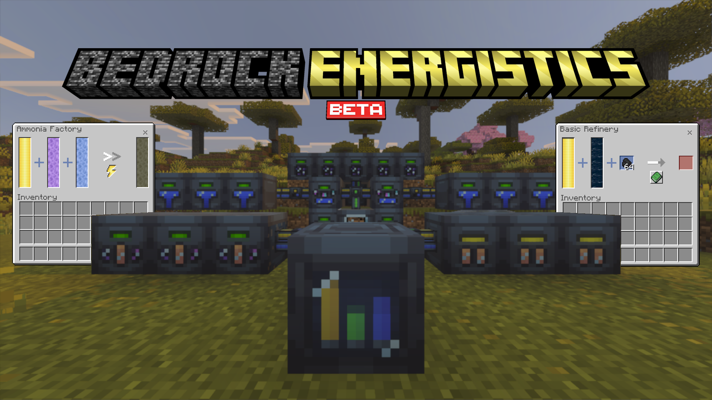

Expands Bedrock with energistics! Adds many machines to Minecraft, with custom UI. Powered by [Bedrock Energistics Core](https://github.com/Fluffyalien1422/bedrock-energistics-core).

Generate energy, move fluids and gases around a base, and put machines to work mining, smelting, and processing for you. Every machine has its own custom UI.

> [!IMPORTANT]
> This add-on is in beta and should not be considered stable. Machines, recipes, and their rates may change between versions.

## Features

- **Over 25 machines.** Generators, processors, machines that make resources, block breakers and placers, and tanks for everything they produce.
- **Custom UI for every machine.**
- **Five tiers of progression,** from machines you can build out of iron up to an endgame chain gated behind plastic.
- **Compatible with other Bedrock Energistics Core add-ons.** Machines from any Core add-on share networks with these, so this add-on's generators can power, for example, an [Advanced Storage Network](https://github.com/Fluffyalien1422/asn) build.

## Requirements

- Minecraft: Bedrock Edition v26.30 or later.
- [Bedrock Energistics Core](https://github.com/Fluffyalien1422/bedrock-energistics-core) v0.12.0.

## Getting Started

You get the Bedrock Energistics Guide Book the first time you spawn into a world, and can craft another from a book and redstone. **Hold it and interact to view all entries, or interact with a machine to open that machine's entry**, which gives you what it takes, what it makes, and how fast. You can also view the guide book [online](https://fluffyalien1422.github.io/bedrock-energistics/).

## Configuration

Configure the add-on by editing `scripts/__config.js` in the behavior pack with any text editor.

Every option is optional and is documented with a comment in the file. Remove an option to use its default. If an option is missing or set to the wrong type, its default is used and a warning is logged to the content log.

## Links

- [Online guide book](https://fluffyalien1422.github.io/bedrock-energistics/)
- [CurseForge](https://www.curseforge.com/minecraft-bedrock/addons/bedrock-energistics)
- [MCPEDL](https://mcpedl.com/bedrock-energistics/)
- [Releases and changelogs](https://github.com/Fluffyalien1422/bedrock-energistics/releases)
- [Bedrock Energistics Core](https://github.com/Fluffyalien1422/bedrock-energistics-core)
- [Vatonage Discord](https://discord.gg/vQuFe77)

## Contributing

**This repository does not accept third-party pull requests.** [Issues](https://github.com/Fluffyalien1422/bedrock-energistics/issues/new/choose) are welcome for bug reports, feature requests, and other feedback. Thanks for your understanding. For questions or help, ask in the [Vatonage Discord](https://discord.gg/vQuFe77).

See [CONTRIBUTING.md](CONTRIBUTING.md) if you are a collaborator.

## License

This project is licensed under the [ISC License](LICENSE).
